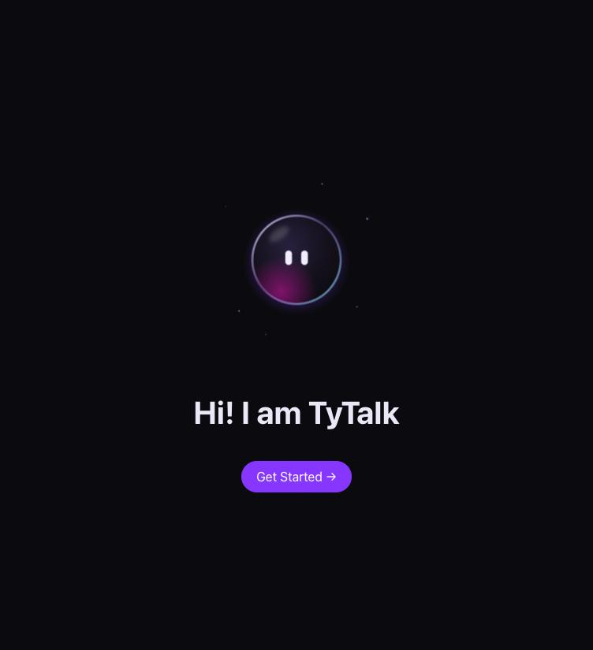
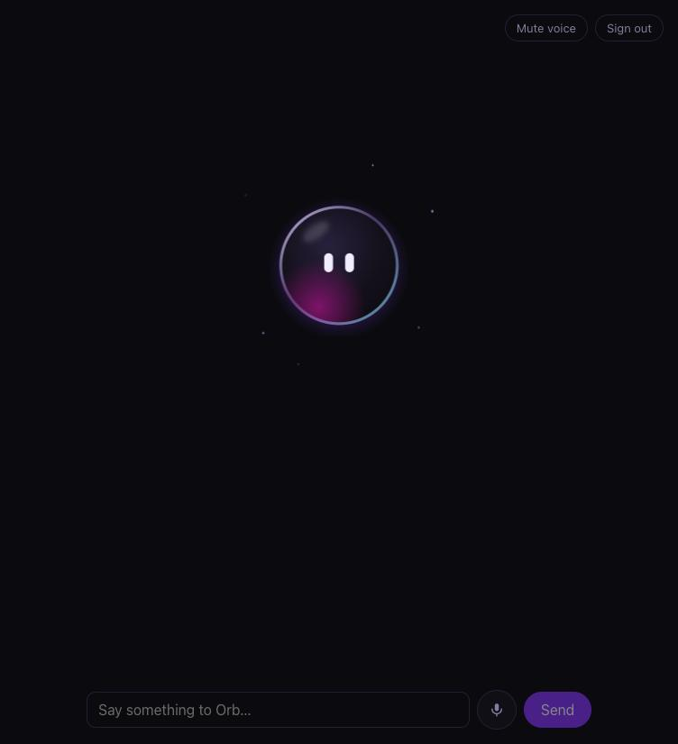
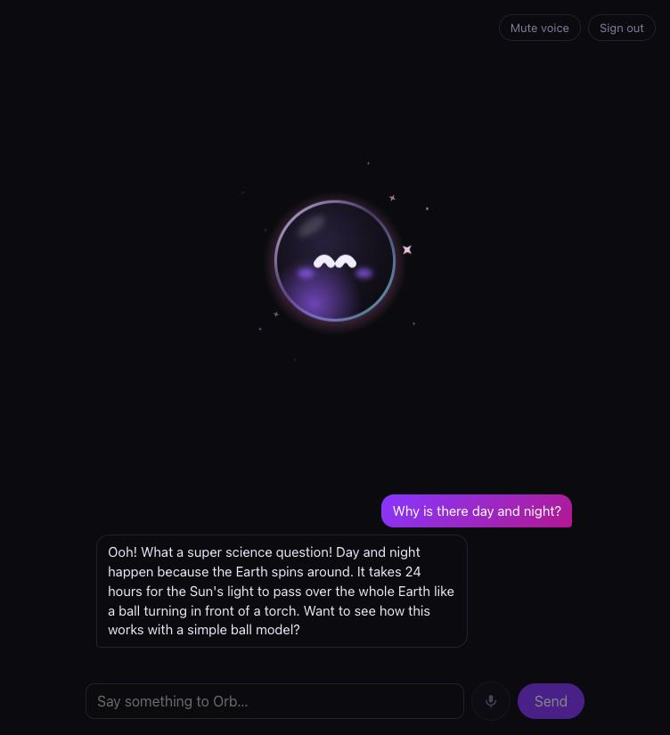

# TyTalk — Every question is a trip into space

<p align="center">
  
</p>

**TyTalk** takes children aged 5 to 15 on a journey through astronomy and space. Kids talk to **Orb**, a friendly star-shaped companion, and Orb answers out loud with short, clear explanations.

Ask why there is day and night, how the Moon changes shape, whether black holes are real, or how a rocket reaches orbit. Each answer comes with pictures, animations and simple simulations, so kids don't just hear about space; they **see** it at work.

<video src="docs/images/tytalk-pitch.mp4" controls width="720"></video>

> [Watch the 30-second pitch video](docs/images/tytalk-pitch.mp4)

---

## The problem

- Astronomy fascinates children, but books and videos are often too long, too dry, or full of jargon.
- Kids ask "Why?" nonstop. Parents and teachers don't always have a simple, accurate, age-appropriate answer ready.
- The internet opens up the whole world, but not all of it is safe for children.

## The solution

TyTalk is a learning companion that:

- **Talks naturally.** Kids ask in their own words, and Orb replies in short, easy-to-follow sentences.
- **Teaches with pictures and simulations.** Orb becomes the Sun, Earth, Moon, a spiral galaxy or a black hole to show exactly what it is describing.
- **Explains with familiar examples.** A ball, a flashlight or a cookie stands in for abstract ideas.
- **Stays on space.** Off-topic questions are gently steered back to the universe.
- **Keeps children safe.** It never asks for personal details such as a school name, address, phone number or photo. Frightening or unsuitable content is declined gently.

<p align="center">
  
  &nbsp;
  
</p>

## What kids and families get

| For kids | For parents and teachers |
|---|---|
| Understand eclipses, seasons and tides | An always-available space tutor that explains at the child's level |
| Ask questions freely, without fear of asking again | Content designed for ages 5–15, not adult material |
| Remember what they learn through pictures and interactive play | No conversation content is stored: only the account and basic personalization |
| A new space fact every day | Easy to use at home or in class, with nothing more than a web browser |

## Highlights of the experience

- **Orb, the star friend**: a cheerful, lively voice that keeps kids curious.
- **Shape-shifting visuals**: Orb turns into the Sun, Earth, Moon, a galaxy or a black hole when the story calls for it.
- **Space simulations**: day and night, Moon phases, solar and lunar eclipses, the Solar System, gravity on Earth, Mars, Jupiter, tides, auroras, the life cycle of a star, and rockets lifting off.
- **Illustrations as Orb speaks**: related pictures appear as the explanation unfolds.
- **Short answers**: a few sentences at a time, enough to understand and enough to make kids want to ask more.

## Who it's for

- **Children aged 5–15** who want to explore the universe in a fun, easy way.
- **Parents** who want their kids to learn real science in a safe environment.
- **Teachers and educators** who need vivid visuals for astronomy lessons.

## Quick start

Requirements: Docker, Python 3.13 and Node.js.

1. Copy the example configuration and fill in your values:

   ```bash
   cp .env.example .env
   ```

   Set `JWT_SECRET` and `LLM_API_KEY`. Never commit `.env`.

2. Start the MySQL database:

   ```bash
   docker compose up -d
   ```

3. Run the backend (FastAPI) and frontend (React + Vite) by following the instructions in `backend/` and `frontend/`.

4. Open the app in your browser, go to the home page and click **Get Started** to start talking with Orb.

## Tech stack

- **Backend**: FastAPI, Python 3.13, MySQL 8, JWT authentication.
- **Frontend**: React, Vite, TypeScript.
- **AI**: works with any OpenAI-compatible endpoint (OpenRouter, OpenAI, DeepSeek, Gemini, Qwen, Anthropic Claude and more). Switching is a configuration change.
- **Deployment**: Docker Compose.

Design and data documentation:

- [Database ERD](docs/erd.md)
- [Space design system](docs/space-design-system.html)

---

**TyTalk**: every question a child asks is a new flight into space.
