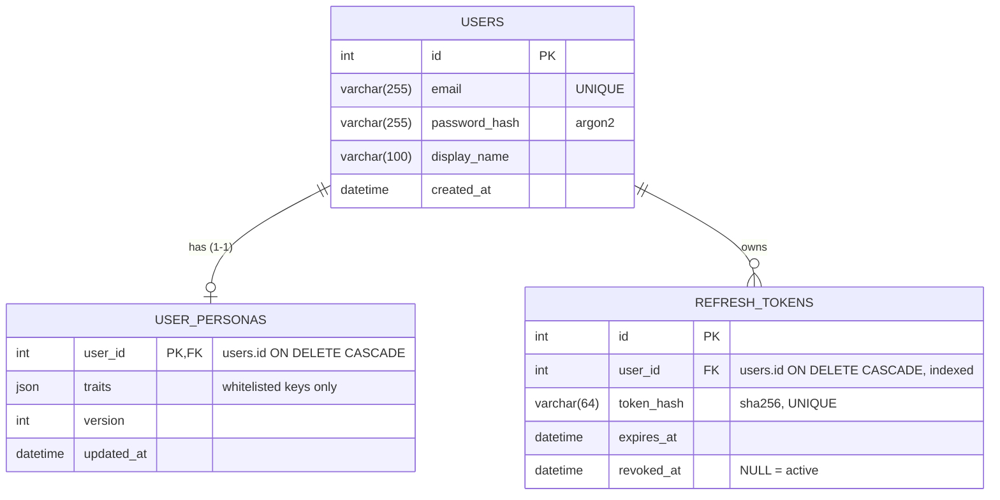

# ERD — TyTalk (MySQL 8)

Conversations are **not** stored. Only identity, refresh sessions and learned personality traits are persisted.

## Isolation rules
- Every query on personas or tokens takes `user_id` from the verified JWT, never from the request body.
- `traits` is the only per-user LLM context. It is whitelisted and size-capped on write (`services/persona_service.py`).
- No table holds message content. Logs must not contain message text.

## Migrations
`backend/migrations/versions/0001_init.py`. Apply with `alembic upgrade head`.
